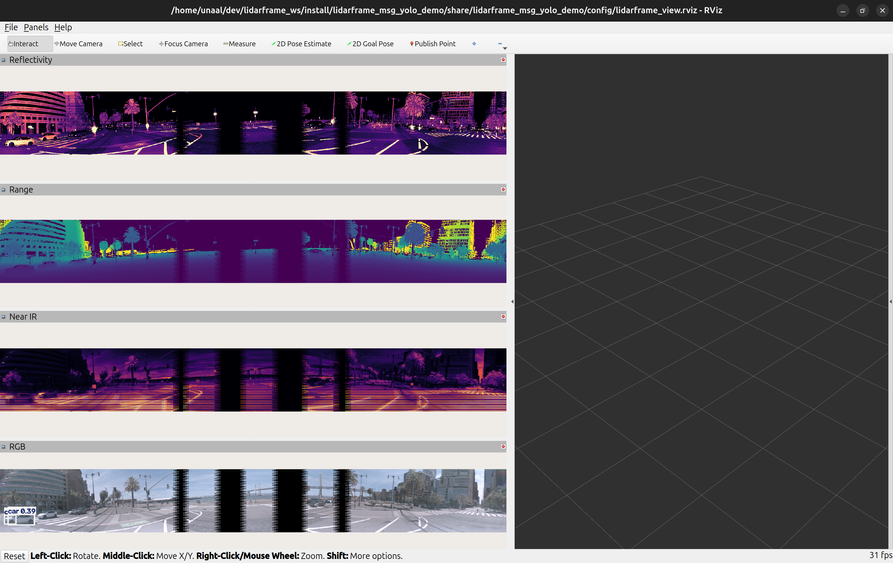

# lidarframe-msg-yolo-demo


## Project Description

**lidarframe-msg-yolo-demo** is a demonstration project written in python that consumes lidar_msgs::LidarInfo and lidar_msgs::LidarFrame messages and runs YOLO object detection directly on structured LidarFrame channels in ROS. It also depends on the package lidar-conversions and invokes the method LidarFrameToPointCloud which takes a
lidar_msgs::LidarInfo and lidar_msgs::LidarFrame and converts them into a PointCloud2 message. The results are visualized using RViz.

### RGB support

When the frame carries an `rgb` channel (e.g. Ouster RGB sensors running the `RNG19_RFL8_SIG16_NIR16_RGB16` profile, published as `datatype = FLOAT16`, `count = 3`), the node additionally:

- tone-maps the linear HDR RGB (percentile auto exposure + gamma) into an 8-bit image, runs YOLO on it and publishes `/ouster_yolo/rgb_annotated`;
- asks `lidar_conversions_py` for a coloured cloud, so `/ouster_yolo/points` gains a packed `rgb` field (shown with RViz's `RGB8` colour transformer).

Sensors without an `rgb` channel keep working unchanged (plain XYZ cloud, no RGB image).

### Parameters

| Parameter | Default | Description |
|---|---|---|
| `lidar_info_topic` | `/ouster/lidar_info` | Latched `LidarInfo` topic |
| `lidar_frame_topic` | `/ouster/lidar_frame` | `LidarFrame` topic |
| `points_topic` | `/ouster_yolo/points` | Output `PointCloud2` |
| `points_organized` | `true` | Organized (HxW) vs. flat cloud |
| `range_channel_name` | `range` | Channel used for projection |
| `color_channel_name` | `rgb` | Channel used to colour the cloud when present (`""` disables) |
| `rgb_auto_percentile` | `99.0` | Percentile mapped to full scale when tone-mapping RGB |
| `rgb_gamma` | `2.2` | Display gamma for RGB |
| `model_name`, `confidence`, `device`, `imgsz` | | YOLO settings |

## Screenshot

Below is a screenshot of the RViz visualization used in this demo:




## Usage

```bash
# producer, e.g. an Ouster RGB sensor (or the virtual sensor)
ros2 launch ouster_ros sensor.launch.xml sensor_hostname:=<host> use_system_default_qos:=true
# consumer + RViz
ros2 launch lidarframe_msg_yolo_demo lidarframe_view.launch.py
```

With `rmw_zenoh_cpp`, large best-effort messages (a 256x2048 `LidarFrame` is ~8 MB) are dropped under congestion, so `use_system_default_qos:=true` (reliable) is recommended on the driver.
